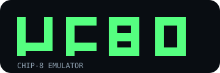
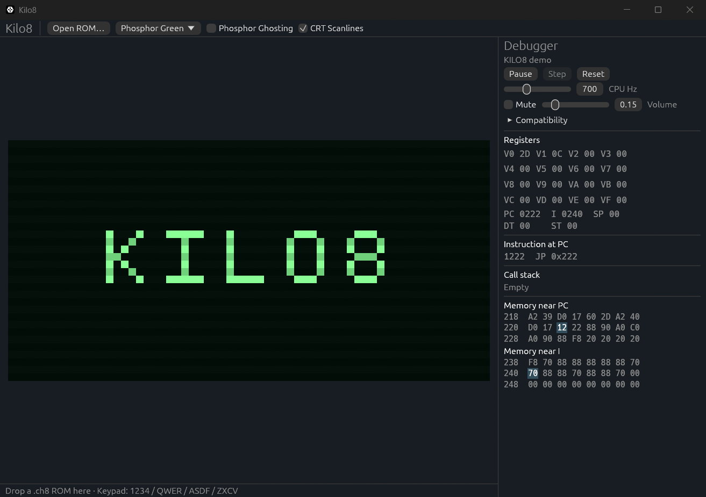

# kilo8

<p>
  
</p>

A clean-room CHIP-8 emulator for Windows, written in Rust.



## Features

- 35 CHIP-8 instructions
- COSMAC VIP and SUPER-CHIP compatibility profiles
- Live debugger for registers, stack, memory, and opcodes
- 64×32 display with Classic Mono, Phosphor Green, and Amber palettes
- Optional phosphor persistence and scanlines
- 440 Hz audio with mute and volume controls
- `.ch8` file picker and drag-and-drop loading

## Controls

| CHIP-8 | 1 | 2 | 3 | C |
|---|---|---|---|---|
| CHIP-8 | 4 | 5 | 6 | D |
| CHIP-8 | 7 | 8 | 9 | E |
| CHIP-8 | A | 0 | B | F |
| QWERTY | `1` | `2` | `3` | `4` |
| QWERTY | `Q` | `W` | `E` | `R` |
| QWERTY | `A` | `S` | `D` | `F` |
| QWERTY | `Z` | `X` | `C` | `V` |

## Build

```powershell
cargo build --release
```

The executable is created at `target\release\kilo8.exe`.

To run directly:

```powershell
cargo run --release
```

## License

Kilo8 is released under the [MIT License](LICENSE). It is a clean-room implementation and does not distribute proprietary ROM files.
